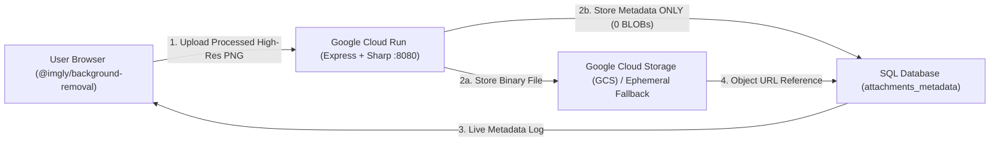

# ClearCut Cloud — High-Resolution AI Image Background Remover

| Field | Details |
| :--- | :--- |
| **Application Name** | ClearCut Cloud — High-Resolution AI Image Background Remover |
| **Subject** | CSEB5233 Designing Applications on Cloud (2627S1) |
| **Student 1** | Abdullah Mujaddid Adli Bin Abdul Halim (`BSW01084329`) |
| **Student 2** | SHAH SIRAJUDDIN BIN KAMARUDIN (`BSW01085924`) |
| **GitHub Repository** | https://github.com/saidid/cseb5233-bg-remover.git |
| **GCP Project / Service** | `cseb5233-bg-remover` / `clearcut-bg-remover` (`us-central1`) |

---

## Project Overview

**ClearCut Cloud** is a production-ready cloud web application designed for **Google Cloud Run** that removes image backgrounds at full original resolution while strictly enforcing **Google Cloud Platform (GCP) dual-layer storage best practices**:

- **Full-Resolution Client-Side AI Segmentation**: Runs `@imgly/background-removal` (ONNX/WASM) directly inside the browser worker to produce edge-accurate transparent PNG cutouts while preserving 100% original pixel resolution.
- **Interactive Before vs. After Studio**: Includes a real-time split-slider comparison, side-by-side mode, transparent checkerboard and custom solid-color backdrop previews, built-in 1024×768 sample image testing, and one-click **Download High-Res PNG**.
- **Backend Binary Validation (`Express` + `sharp`)**: Validates real decoded image bytes, pixel dimensions, alpha transparency, file size, and MIME type via `POST /api/process-metadata`.
- **GCP Best-Practice Storage Decoupling (0 SQL BLOBs)**:
  - **Object Storage Layer (`storageService.js`)**: Stores processed image binaries in **Google Cloud Storage (`@google-cloud/storage`)** whenever `GCS_BUCKET_NAME` is configured, with a seamless bounded ephemeral fallback (`/api/objects/:objectId`) so the service runs 100% error-free locally and on Cloud Run even when no bucket is attached.
  - **SQL Metadata Layer (`database.js`)**: Uses `better-sqlite3` (`attachments_metadata`) to record **only lightweight relational metadata** (`id`, `file_name`, `file_url`, `file_size`, `content_type`, `resolution`, `created_at`) — **never `file_blob`**.

---

## System Architecture

### ASCII Architecture Diagram (`User -> Cloud Run -> GCS for Files + SQL for Metadata`)

```text
+-------------------------------------------------------------------------+
|                            USER BROWSER                                 |
|   Tailwind Glassmorphism UI + @imgly/background-removal (ONNX/WASM)     |
|   - Drag & Drop / File Picker (JPG, PNG, WEBP)                          |
|   - Full-Res Transparent PNG Extraction + Before/After + Download       |
+-----------------------------------+-------------------------------------+
                                    |
                                    | HTTPS (POST /api/process-metadata
                                    |        GET  /api/metadata)
                                    v
+-------------------------------------------------------------------------+
|               GOOGLE CLOUD RUN (clearcut-bg-remover)                    |
|              Node.js 20 Container | Express | 0.0.0.0:8080              |
|                                                                         |
|   [Multer Memory Upload] ---> [Sharp Binary Validator (W x H, MIME)]    |
|                                       |                                 |
|                     +-----------------+-----------------+               |
|                     |                                   |               |
|                     | Binary Image Files                | Metadata ONLY |
|                     | (PNG / JPG / WEBP)                | (0 BLOBs)     |
|                     v                                   v               |
+---------------------+-----------------------------------+---------------+
                      |                                   |
                      v                                   v
+---------------------------------------+   +-----------------------------+
|        OBJECT STORAGE LAYER           |   |     SQL METADATA LAYER      |
|          (storageService.js)          |   |        (database.js)        |
|                                       |   |                             |
|  Google Cloud Storage (GCS)           |   |  Table: attachments_metadata|
|  gs://<GCS_BUCKET_NAME>/processed/... |   |  - id (PK)                  |
|                                       |   |  - file_name (TEXT)         |
|  (Auto Ephemeral Fallback when        |   |  - file_url  (TEXT)         |
|   GCS_BUCKET_NAME is unset)           |   |  - file_size (INTEGER)      |
|                                       |   |  - content_type (TEXT)      |
|                                       |   |  - resolution (TEXT)        |
|                                       |   |  - created_at (DATETIME)    |
+---------------------------------------+   +-----------------------------+
```

### Mermaid Architecture Diagram



---

## Why Zero BLOBs in SQL? (GCP Best Practice)

Storing attachments as `BLOB` / `BYTEA` / `VARBINARY` columns inside Cloud SQL severely degrades performance and rapidly consumes GCP credits:

| Factor | Anti-Pattern (`attachments(id, file_blob)`) | ClearCut Cloud (`GCS + attachments_metadata`) |
| :--- | :--- | :--- |
| **Storage Cost** | Expensive Cloud SQL SSD storage | **10–20× cheaper** via Google Cloud Storage |
| **CPU, RAM & Disk I/O** | Every `SELECT`/`INSERT` reads/writes multi-MB binaries | Lightweight text & integer metadata queries only |
| **Automated Backups** | Daily backups & binlogs multiply binary storage | Minimal SQL backup footprint |
| **Scalability** | Forced vertical DB scaling | Independent stateless Cloud Run + GCS scaling |

### SQL Schema (`attachments_metadata`)

```sql
CREATE TABLE IF NOT EXISTS attachments_metadata (
  id INTEGER PRIMARY KEY AUTOINCREMENT,
  file_name TEXT NOT NULL,
  file_url TEXT NOT NULL,
  file_size INTEGER NOT NULL,
  content_type TEXT NOT NULL,
  resolution TEXT NOT NULL,
  created_at DATETIME DEFAULT CURRENT_TIMESTAMP
);
```

---

## API Endpoints

| Method | Endpoint | Description |
| :--- | :--- | :--- |
| `GET` | `/api/health` | Cloud Run readiness probe + zero-BLOB schema & storage driver audit |
| `POST` | `/api/process-metadata` | Validates image via `sharp`, stores binary in Object Storage, logs metadata to SQL |
| `GET` | `/api/metadata` | Returns latest rows from `attachments_metadata` + architecture KPIs |
| `DELETE` | `/api/metadata/:id` | Deletes a metadata row (and evicts ephemeral fallback object if present) |
| `GET` | `/api/objects/:objectId` | Serves processed image binary when running in ephemeral fallback mode |

---

## Running Locally

### Prerequisites
- Node.js `v20+`

### Clone, Install & Run
```bash
git clone https://github.com/saidid/cseb5233-bg-remover.git
cd cseb5233-bg-remover
npm install
npm start
```

> **Windows PowerShell Note:** If PowerShell execution policy restricts `.ps1` wrappers, use `npm.cmd install`, `npm.cmd start`, and `gcloud.cmd`.

Open `http://localhost:8080` in your browser.

---

## Docker & Google Cloud Run Deployment

### Build & Test Container Locally
```bash
docker build -t clearcut-bg-remover .
docker run -p 8080:8080 -e PORT=8080 clearcut-bg-remover
```

### Enable Required GCP APIs (First-Time Project Setup)
```bash
gcloud services enable run.googleapis.com cloudbuild.googleapis.com artifactregistry.googleapis.com \
  --project cseb5233-bg-remover
```

### Deploy Directly from Source to Google Cloud Run
```bash
gcloud run deploy clearcut-bg-remover \
  --source . \
  --region us-central1 \
  --allow-unauthenticated \
  --port 8080 \
  --memory 1Gi \
  --project cseb5233-bg-remover
```

### Optional: Attach a Google Cloud Storage Bucket for Persistent Object Storage
```bash
gcloud run services update clearcut-bg-remover \
  --region us-central1 \
  --set-env-vars GCS_BUCKET_NAME=YOUR_GCS_BUCKET_NAME \
  --project cseb5233-bg-remover
```

---

## Stopping Billing / Shutting Down Your GCP Project

After completing your presentation and grading, shut down the GCP project to stop all future charges:
1. Open [Google Cloud Console](https://console.cloud.google.com/).
2. Select project **`cseb5233-bg-remover`** in the top bar.
3. Go to **IAM & Admin → Settings**.
4. Click **SHUT DOWN**, type `cseb5233-bg-remover`, and confirm.
